# Toothbrush Timer

A sleek bathroom clock and toothbrush timer for the round
[Waveshare ESP32-S3-Touch-LCD-2.8C](https://docs.waveshare.com/ESP32-S3-Touch-LCD-2.8C)
(480×480 ST7701 display, GT911 touch, PCF85063 RTC, buzzer).

| Idle clock | One timer | Two timers | Four timers |
| :---: | :---: | :---: | :---: |
|  | 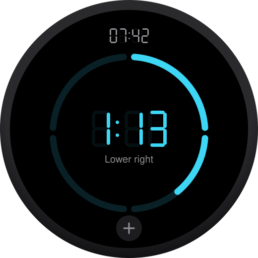 | 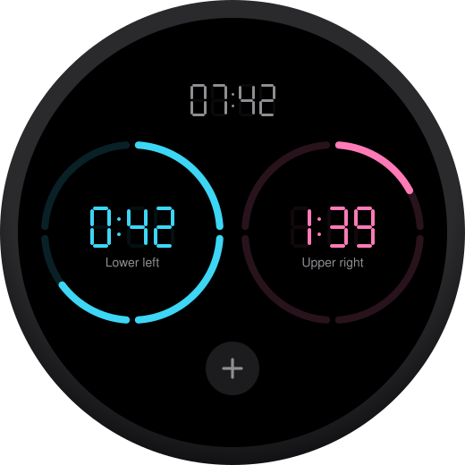 |  |
| **Three timers + add slot** | **Done (2:00 reached)** | **Count-up mode** | **Settings** |
| 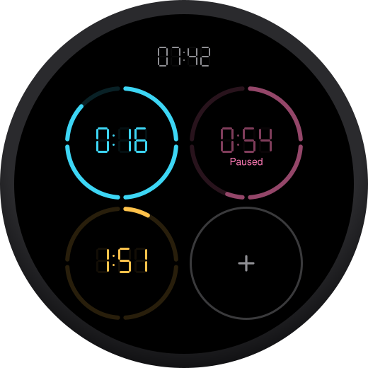 | 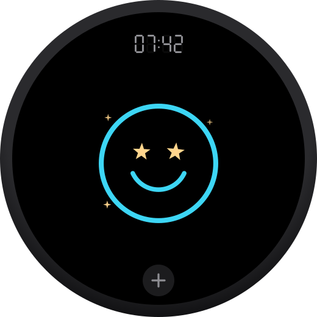 |  | 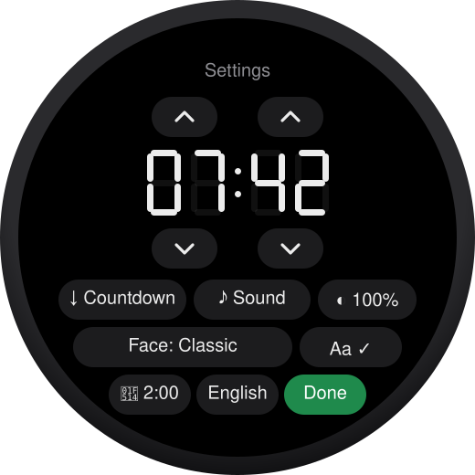 |

### Clock faces

**Classic** keeps the original look. **Synthwave** adds a striped sunset, a perspective grid that
slowly cycles through neon colors, and a seconds ring that reveals a fixed gradient as the minute
progresses. **Flower Power** takes its cue from late-'60s screen prints: a cream dial, bold
daisies, curved stripes, and a rim that lights one dot or daisy per second, then resets each
minute. **Christmas** (Danish: **Jul**) pairs a deep evergreen dial with hanging ornaments,
a little winter forest, and a gold seconds sweep. Hold the idle clock to open Settings, tap **Face** (Danish:
**Urskive**) to cycle the options, then tap **Done** to save. The browser simulator also has a
**Clock face** selector. Timer screens and the long-idle screensaver are shared by all faces.

| Synthwave | Flower Power | Christmas |
| :---: | :---: | :---: |
|  | 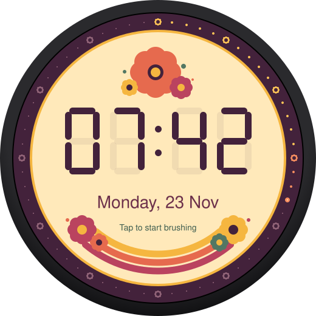 | 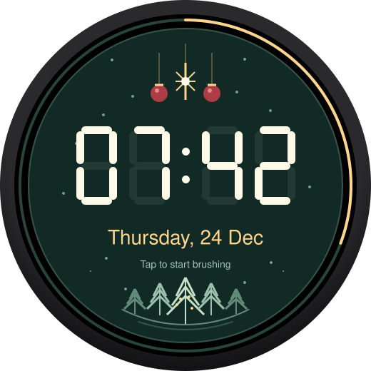 |

### Long-idle screensaver

After 15 minutes without touch and with no timer running, the clock settles into a dim screensaver:
the seconds ring fades away and the accent starts cycling through the timer palette. The clock
and date stay centered for the first 5 minutes of screensaver mode, then gently drift.
Use **Exit screensaver** in the browser preview to wake the clock without starting a timer.


### Birthday flags

On a listed birthday, two Danish flags wave above the idle clock, with soft highlights that follow
the folds. They stay out of the way while a timer is visible or the screensaver is running.

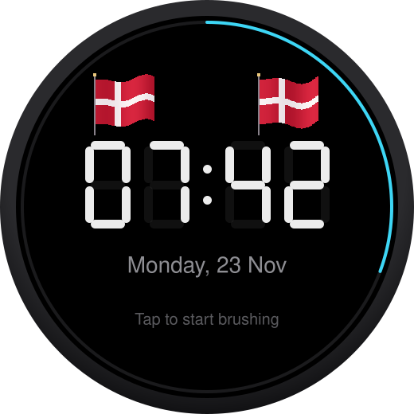

Add recurring dates to `kBirthdays` in [`src/ui/ui.cpp`](src/ui/ui.cpp) and rebuild the firmware.
Entries are `{month, day}` (for example, `{6, 14},` is 14 June); no dates are enabled by default.
To see the animation without changing the date, turn on **Preview birthday flags** in the simulator.
Use **Birthday flag layout** to compare the default with the mirrored version.

### Transitions

Starting the first timer – the date fades, the big clock glides up into a small header and the ring blooms in:

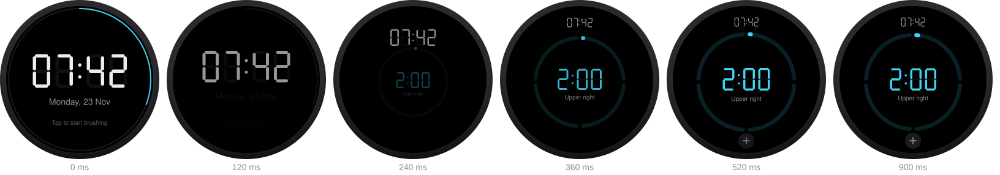

Adding a timer – the "+" morphs into the new ring while the existing ring slides aside:


Last timer removed – the ring shrinks away and the big clock returns:

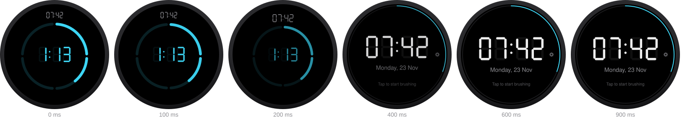

### Oral-B toothbrush timers

| Brushing | Too hard | Mixed with manual timers |
| :---: | :---: | :---: |
| 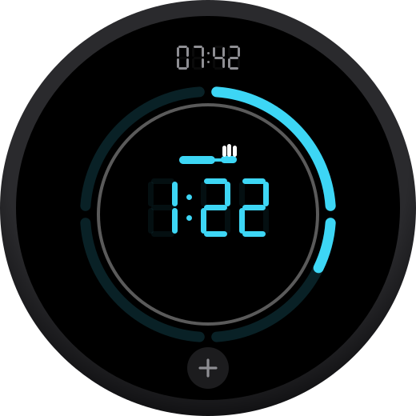 |  |  |


## Features

- **Clock** – large segment-style `HH:MM`, date, and a sweeping seconds ring. Time is kept by the
  on-board PCF85063 RTC (the system clock is re-synced from it every 10 minutes).
- **Brush timers** – tap the clock to start a 2-minute timer. The ring is split into four mouth
  quadrants (upper right → lower right → lower left → upper left), one per 30 seconds.
- **Several timers at once** – up to 4 (one per family member, each in its own color). The layout
  adapts: one big ring, two side by side, or a 2×2 grid with a "+" slot.
- **Countdown or count-up** – selectable in settings. After 2:00 the ring turns green and keeps
  counting the overtime; finished timers disappear automatically after 1 minute.
- **Smooth transitions** – every layout change is animated (eased moves, springy ring bloom,
  fades); rings "breathe" briefly on each 30 s mark and with a bigger pulse when done; the
  settings screen cross-fades; the backlight fades in on boot and fades when dimming/waking.
- **Buzzer cues** – the on-board active buzzer is switched on or off; software can't adjust its volume.
  Short cues mark brushing progress. Power-up, settings, pause/resume and cancelling are silent.
  | Event | Pattern |
  | --- | --- |
  | Timer started | One 45 ms pip |
  | 0:30 / 1:00 / 1:30 | One / two / three 30 ms pips |
  | 2:00 reached | Two longer pips (45 ms and 75 ms) |
- **Auto-dim and screensaver** – the backlight dims after 3 minutes without touches when no timer
  is running, then drops to 8% brightness after 15 minutes. The screensaver keeps a soft, color-cycling
  clock and date on screen, with a slow position shift starting at 20 minutes of total inactivity.
  Touching the screen wakes it smoothly.
- **Oral-B toothbrush integration** – switching on an Oral-B Bluetooth brush (iO series tested in
  the protocol fixtures; other Bluetooth models use the same advertisement) automatically starts a
  timer with a toothbrush icon, synced to the brush's own session clock. See
  [Oral-B toothbrushes](#oral-b-toothbrushes).
- **English and Danish** – switch in settings (stored in flash; Danish is the default on first
  boot). Danish screenshots: [docs/screens/da](docs/screens/da).

  | Idle | Timers | Settings |
  | :---: | :---: | :---: |
  | 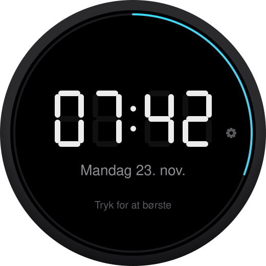 | 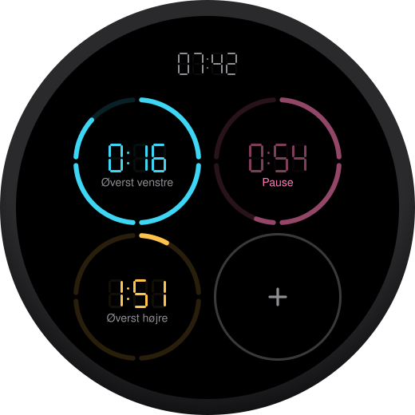 | 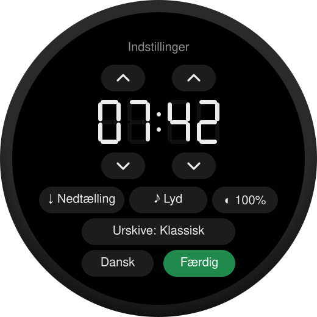 |

## Using it

| Where | Tap | Hold (0.7 s) |
| --- | --- | --- |
| Idle clock | start a timer | open settings |
| Timer ring | pause / resume (dismiss when done) | cancel the timer |
| Toothbrush ring | – while brushing (dismiss when done) | dismiss the timer |
| **+** button / empty slot | add another timer | – |

**Settings** lets you set the time (hold the arrows to repeat), switch countdown/count-up,
mute the buzzer and change the language. Settings are stored in flash (NVS); the time is
written to the RTC.

> **Keeping time without power:** the RTC only survives power loss with a rechargeable cell
> connected to the board's *RTC battery header*. Without one, the firmware seeds the
> clock from the firmware build time on first boot – just correct it in settings.

## Oral-B toothbrushes

Oral-B Bluetooth brushes broadcast their status in BLE advertisements (manufacturer data, company
ID `0x00DC`) several times per second. The timer listens **passively** – it never connects or
pairs, so the Oral-B app keeps working normally and nothing needs to be set up.

| Brush | Timer |
| --- | --- |
| Switched on | a toothbrush timer appears ("bi-bi-beeep"), already at the brush's own time |
| Switched off | the timer pauses |
| On again within 30 s | the same timer resumes silently |
| Off for more than 30 s | the timer disappears |
| Out of range / silent for 4 s | treated as switched off |

- Toothbrush timers show a **toothbrush icon** and an **inner pressure ring**: soft white
  normally, **red with "Too hard"** (and a small pulse) while the brush reports too much pressure.
- The 30 s / 2:00 sounds are the same as for manual timers. Several brushes are tracked
  independently (each gets its own ring, up to 4 timers in total).
- Tapping a toothbrush ring does nothing while brushing (use the brush's button); tap a finished
  one to dismiss it. Holding a ring dismisses it – it won't come back until that brush has been
  off for 30 s.
- **Pressure colors:** the passive advertisement only carries a "too hard" flag. The brush's
  white/green distinction (too soft vs. optimal) is only available over an active GATT connection,
  so the ring stays neutral white instead of turning green.
- BLE scanning uses [NimBLE-Arduino](https://github.com/h2zero/NimBLE-Arduino) (downloaded by
  PlatformIO). Protocol details are based on the open-source
  [oralb-ble](https://github.com/Bluetooth-Devices/oralb-ble) parser.

## Previews

- `docs/screens/*.svg` – static screenshots (regenerate with `node preview/render.js`)
- `preview/index.html` – interactive simulator: open it in a browser, click/hold on the screen,
  preview the long-idle screensaver, speed up time, hear the buzzer patterns and switch two virtual
  Oral-B brushes on/off.

The preview (`preview/sim.js`) is a port of the timer logic, scene animations, layout and drawing
code, so the screenshots match the device geometry. Keep it in sync when changing the UI.
`node preview/render.js` also writes the transition filmstrips.

## Building and flashing

Requires [PlatformIO](https://platformio.org/) (VS Code extension or CLI). Libraries (LVGL 8.3,
NimBLE-Arduino) are downloaded automatically.

```sh
pio run -e waveshare_28c                 # build
pio run -e waveshare_28c -t upload       # flash via the USB-C "UART" port
pio device monitor                       # serial log at 115200 baud
pio test -e native                       # unit tests for the timer logic (needs a host C compiler)
```

If the upload doesn't start automatically, hold **BOOT**, tap **RESET**, release **BOOT** and retry.

## Project layout

```
platformio.ini            board + build configuration (ESP32-S3, 16 MB flash, 8 MB OPI PSRAM)
include/lv_conf.h         LVGL configuration
lib/brush_core/           platform-independent logic (unit tested)
  brush_core.*            timers, 30 s marks, screen layout
  brush_scene.*           animated scene: tweens/easing between layouts, ring pulses
  brush_i18n.*            English/Danish strings and date format
  brush_oralb.*           Oral-B advertisement parser + brush-to-timer tracking
src/main.cpp              setup/loop, LVGL glue, timekeeping, settings, app actions
src/board/                hardware drivers
  pins.h                  pin map (from the board schematic)
  exio.*                  TCA9554 IO expander (LCD/touch reset, LCD CS, buzzer)
  display.*               ST7701 init over 3-wire SPI + RGB565 panel + PWM backlight
  touch.*                 GT911 touch controller
  rtc_pcf85063.*          PCF85063 real-time clock
  buzzer.*                buzzer sound patterns (FreeRTOS task)
  oralb_scanner.*         passive BLE scan (NimBLE) for Oral-B advertisements
src/ui/                   LVGL user interface
  seg_digits.*            scalable segment-style digits (custom drawn)
  brush_icon.*            scalable toothbrush icon (custom drawn)
  ui.*                    idle clock, adaptive timer rings, settings screen
  fonts/                  Montserrat 14/20/28 with ÆØÅæøå + LVGL symbols (generated)
test/test_brush_core/     Unity tests for lib/brush_core
preview/                  browser simulator + SVG screenshot renderer
```

## Hardware notes

| Function | Connection |
| --- | --- |
| I2C (touch, RTC, IMU, expander) | SDA GPIO15, SCL GPIO7 |
| LCD RGB data | B: 5, 45, 48, 47, 21 · G: 14, 13, 12, 11, 10, 9 · R: 46, 3, 8, 18, 17 |
| LCD sync | HSYNC 38, VSYNC 39, DE 40, PCLK 41 |
| LCD init SPI | SDA GPIO1, SCK GPIO2, CS = expander P2 |
| Backlight | GPIO6 (PWM) |
| Touch INT / RST | GPIO16 / expander P1 |
| LCD reset | expander P0 |
| Buzzer | expander P7 (active buzzer, on/off) |

Tunables (durations, brightness, dimming, default language) are at the top of `src/main.cpp`;
colors and layout are in `src/ui/ui.cpp` and `lib/brush_core/src/brush_core.c`.

Montserrat is licensed under the SIL Open Font License 1.1 and FontAwesome Free under the
SIL OFL 1.1 (fonts); both are redistributed by LVGL.

## Translations and fonts

All user-visible text lives in `lib/brush_core/src/brush_i18n.c` (mirrored in `preview/sim.js`).
LVGL's built-in fonts are ASCII-only, so `src/ui/fonts/tb_font_*.c` were generated with
[lv_font_conv](https://github.com/lvgl/lv_font_conv) from the Montserrat-Medium and FontAwesome
files in LVGL's `scripts/built_in_font` folder. Text using characters outside the font renders as
boxes – when adding a language or characters, extend the `-r` ranges and regenerate (run in that
folder, once per size 14/20/28):

```sh
npx lv_font_conv@1.5.2 --no-compress --no-prefilter --bpp 4 --size 20 \
  --font Montserrat-Medium.ttf -r 0x20-0x7F,0xB0,0x2022,0xC5,0xC6,0xD8,0xE5,0xE6,0xF8 \
  --font FontAwesome5-Solid+Brands+Regular.woff \
  -r 61441,61448,61451,61452,61453,61457,61459,61461,61465,61468,61473,61478,61479,61480,61502,61507,61512,61515,61516,61517,61521,61522,61523,61524,61543,61544,61550,61552,61553,61556,61559,61560,61561,61563,61587,61589,61636,61637,61639,61641,61664,61671,61674,61683,61724,61732,61787,61931,62016,62017,62018,62019,62020,62087,62099,62212,62189,62810,63426,63650 \
  --format lvgl --force-fast-kern-format --lv-include lvgl.h -o tb_font_20.c
```
